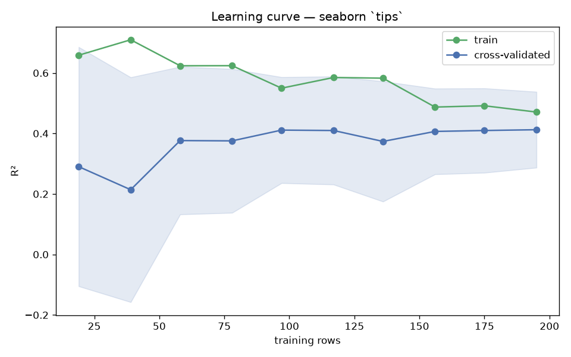

# Day 54 — seaborn `tips` (244 rows · 6 features)

**Question:** How much of the data does the model actually need?

**Method:** Ran a learning curve for a scaled linear model over 10 training-set sizes with 5-fold CV, tracking train and cross-validated scores.

**Insights**
1. CV R² reaches 0.412 at the full 195 training rows, up from 0.290 at 19 rows.
2. **97 rows (50% of the data) already get within 2% of the final score** — the curve is flat well before the data runs out.
3. Train sits 0.058 above CV at full size, so the model is overfitting and more data would still help.

**Next question this raises:** Does a non-linear model keep improving where the linear one flattens out?

