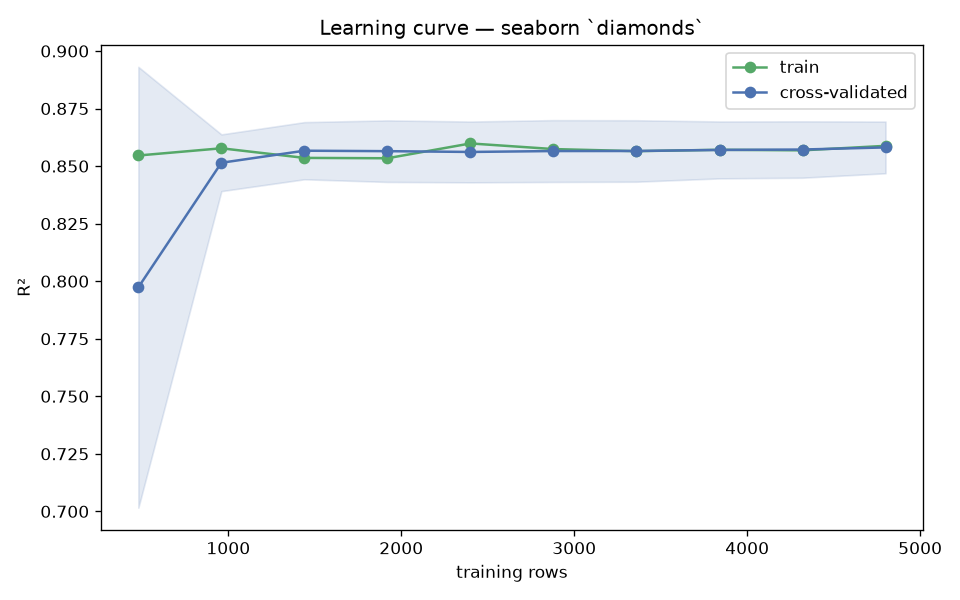

# Day 57 — seaborn `diamonds` (6,000 rows · 9 features)

**Question:** How much of the data does the model actually need?

**Method:** Ran a learning curve for a scaled linear model over 10 training-set sizes with 5-fold CV, tracking train and cross-validated scores.

**Insights**
1. CV R² reaches 0.858 at the full 4800 training rows, up from 0.797 at 480 rows.
2. **960 rows (20% of the data) already get within 2% of the final score** — the curve is flat well before the data runs out.
3. Train sits 0.001 above CV at full size, so the model is not memorising — more data would not help much.

**Next question this raises:** Does a non-linear model keep improving where the linear one flattens out?

