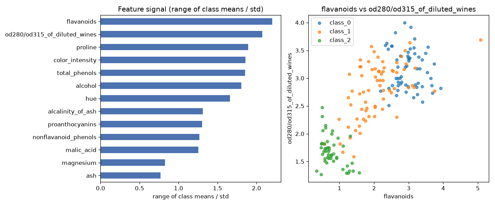

# Day 58 — sklearn `wine` (178 rows · 13 features)

**Question:** Which features carry the most signal about the target?

**Method:** Scored every numeric feature by range of class means / std, ranked them, and plotted the top two against each other.

**Insights**
1. **flavanoids** carries the most signal (2.20 on range of class means / std), followed by **od280/od315_of_diluted_wines** (2.08).
2. The top feature is **3× stronger** than the weakest (**ash**, 0.77) — the signal is far from evenly spread.
3. 0 of 13 features (0%) score below a quarter of the leader — the useful signal is spread across a wide middle tier, not just the top few.

**Next question this raises:** Do the top-ranked features stay on top once a model sees them together?

