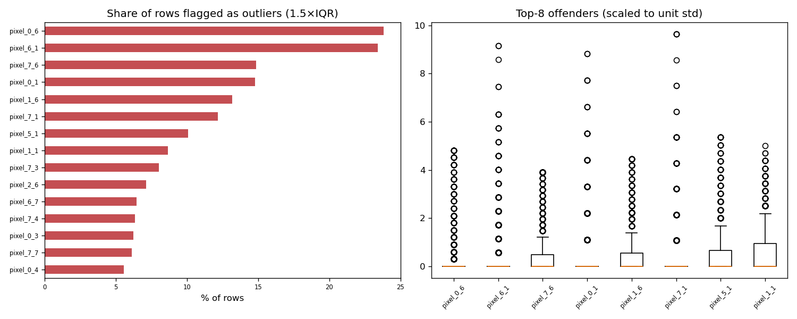

# Day 60 — sklearn `digits` (1,797 rows · 61 features)

**Question:** Where are the outliers, and how much do they move the summary statistics?

**Method:** Flagged values outside 1.5×IQR per feature, counted the share of affected rows, and recomputed the worst feature's mean with them removed.

**Insights**
1. **pixel_0_6** has the most extreme values — 23.8% of rows fall outside 1.5×IQR.
2. 1308 of 1797 rows (72.8%) are an outlier on at least one feature, so dropping outlier rows wholesale would cost a large slice of the data.
3. Trimming pixel_0_6's outliers moves its mean by 0.41 std (1.36 → 0.00) — a material shift.

**Next question this raises:** Does a robust scaler beat a standard scaler on this data?

