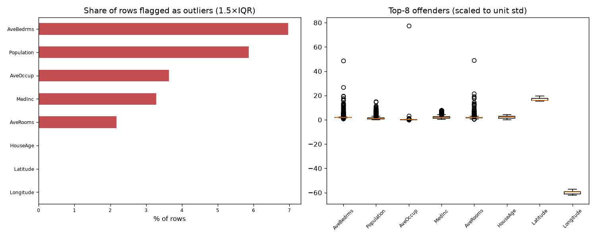

# Day 61 — sklearn `california_housing` (6,000 rows · 8 features)

**Question:** Where are the outliers, and how much do they move the summary statistics?

**Method:** Flagged values outside 1.5×IQR per feature, counted the share of affected rows, and recomputed the worst feature's mean with them removed.

**Insights**
1. **AveBedrms** has the most extreme values — 7.0% of rows fall outside 1.5×IQR.
2. 1119 of 6000 rows (18.6%) are an outlier on at least one feature, so dropping outlier rows wholesale would cost a large slice of the data.
3. Trimming AveBedrms's outliers moves its mean by 0.10 std (1.10 → 1.05) — a material shift.

**Next question this raises:** Does a robust scaler beat a standard scaler on this data?

