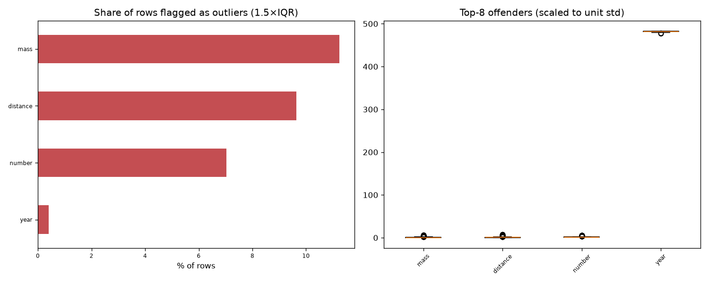

# Day 63 — seaborn `planets` (1,035 rows · 5 features)

**Question:** Where are the outliers, and how much do they move the summary statistics?

**Method:** Flagged values outside 1.5×IQR per feature, counted the share of affected rows, and recomputed the worst feature's mean with them removed.

**Insights**
1. **mass** has the most extreme values — 11.2% of rows fall outside 1.5×IQR.
2. 131 of 498 rows (26.3%) are an outlier on at least one feature, so dropping outlier rows wholesale would cost a large slice of the data.
3. Trimming mass's outliers moves its mean by 0.30 std (2.51 → 1.43) — a material shift.

**Next question this raises:** Does a robust scaler beat a standard scaler on this data?

