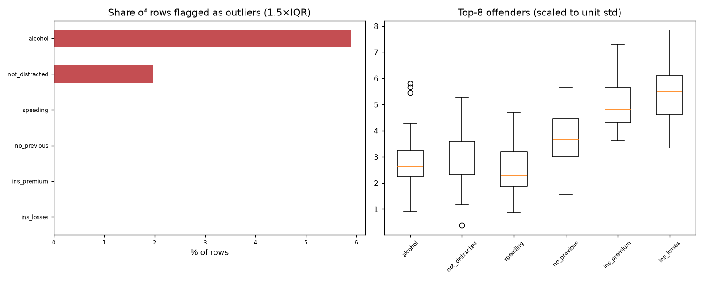

# Day 64 — seaborn `car_crashes` (51 rows · 7 features)

**Question:** Where are the outliers, and how much do they move the summary statistics?

**Method:** Flagged values outside 1.5×IQR per feature, counted the share of affected rows, and recomputed the worst feature's mean with them removed.

**Insights**
1. **alcohol** has the most extreme values — 5.9% of rows fall outside 1.5×IQR.
2. 4 of 51 rows (7.8%) are an outlier on at least one feature, so dropping outlier rows wholesale would cost a large slice of the data.
3. Trimming alcohol's outliers moves its mean by 0.18 std (4.89 → 4.58) — a material shift.

**Next question this raises:** Does a robust scaler beat a standard scaler on this data?

