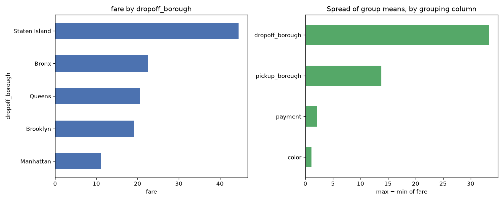

# Day 65 — seaborn `taxis` (6,433 rows · 12 features)

**Question:** Which categorical column splits the target most?

**Method:** Grouped by each low-cardinality category column, computed fare per group, and compared the spread of group means across columns.

**Insights**
1. **dropoff_borough** splits the target hardest: fare runs from 11.195 (**Manhattan**) to 44.500 (**Staten Island**).
2. That is a 33.305 gap against an overall level of 13.091 — 254% of the baseline.
3. The weakest grouping (**color**) spans only 1.121, so not every category column is worth encoding.

**Next question this raises:** Do those group gaps survive once the numeric features are controlled for?

