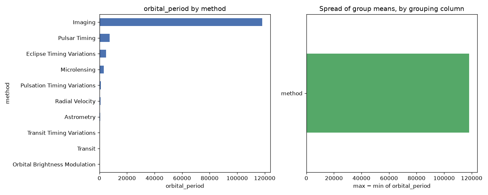

# Day 66 — seaborn `planets` (1,035 rows · 5 features)

**Question:** Which categorical column splits the target most?

**Method:** Grouped by each low-cardinality category column, computed orbital_period per group, and compared the spread of group means across columns.

**Insights**
1. **method** splits the target hardest: orbital_period runs from 0.709 (**Orbital Brightness Modulation**) to 118247.738 (**Imaging**).
2. That is a 118247.028 gap against an overall level of 2002.918 — 5904% of the baseline.
3. The weakest grouping (**method**) spans only 118247.028, so not every category column is worth encoding.

**Next question this raises:** Do those group gaps survive once the numeric features are controlled for?

