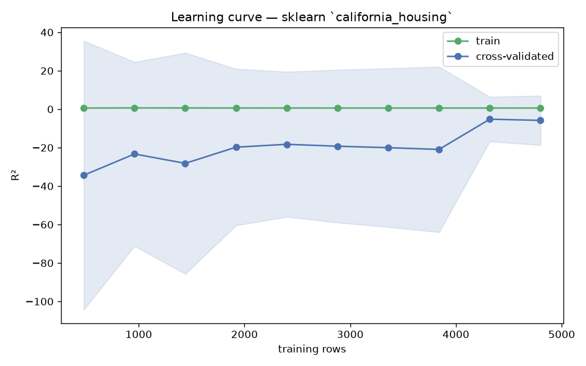

# Day 68 — sklearn `california_housing` (6,000 rows · 8 features)

**Question:** How much of the data does the model actually need?

**Method:** Ran a learning curve for a scaled linear model over 10 training-set sizes with 5-fold CV, tracking train and cross-validated scores.

**Insights**
1. CV R² reaches -5.829 at the full 4800 training rows, up from -34.365 at 480 rows.
2. **4320 rows (90% of the data) already get within 2% of the final score** — the curve is flat well before the data runs out.
3. Train sits 6.432 above CV at full size, so the model is overfitting and more data would still help.

**Next question this raises:** Does a non-linear model keep improving where the linear one flattens out?

