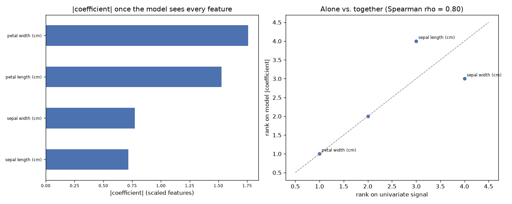

# Day 73 — sklearn `iris` (150 rows · 4 features)

**Question:** Do the top-ranked features stay on top once a model sees them together?

**Method:** Ranked features one at a time by univariate signal, then fitted a scaled linear model on all of them and compared the two rankings place by place.

**Insights**
1. The fitted model leans hardest on **petal width (cm)**, which the univariate ranking only placed #1 of 4.
2. 4 of the top 4 univariate features are still in the model's top 4 (Spearman rho = 0.80 across all 4) — the two views mostly agree.
3. **sepal width (cm)** moves the furthest, 1 places, which is what correlated features do once they have to share the credit.

**Next question this raises:** If the rankings disagree, which one picks the better small subset?

