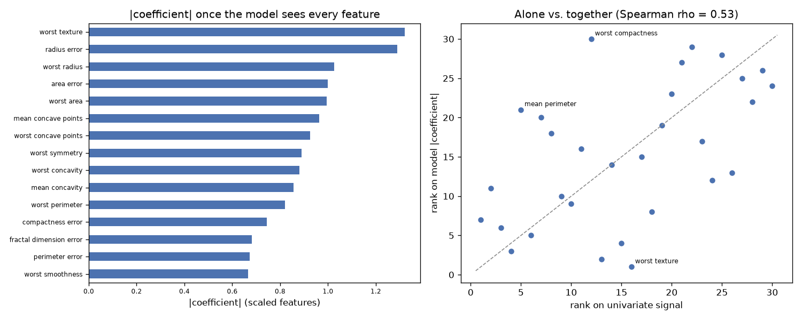

# Day 74 — sklearn `breast_cancer` (569 rows · 30 features)

**Question:** Do the top-ranked features stay on top once a model sees them together?

**Method:** Ranked features one at a time by univariate signal, then fitted a scaled linear model on all of them and compared the two rankings place by place.

**Insights**
1. The fitted model leans hardest on **worst texture**, which the univariate ranking only placed #16 of 30.
2. 1 of the top 5 univariate features are still in the model's top 5 (Spearman rho = 0.53 across all 30) — the two views disagree more than they agree.
3. **worst compactness** moves the furthest, 18 places, which is what correlated features do once they have to share the credit.

**Next question this raises:** If the rankings disagree, which one picks the better small subset?

