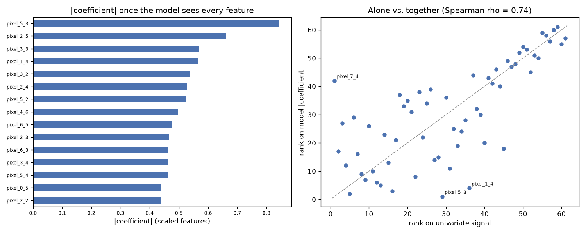

# Day 76 — sklearn `digits` (1,797 rows · 61 features)

**Question:** Do the top-ranked features stay on top once a model sees them together?

**Method:** Ranked features one at a time by univariate signal, then fitted a scaled linear model on all of them and compared the two rankings place by place.

**Insights**
1. The fitted model leans hardest on **pixel_5_3**, which the univariate ranking only placed #29 of 61.
2. 1 of the top 5 univariate features are still in the model's top 5 (Spearman rho = 0.74 across all 61) — the two views mostly agree.
3. **pixel_7_4** moves the furthest, 41 places, which is what correlated features do once they have to share the credit.

**Next question this raises:** If the rankings disagree, which one picks the better small subset?

