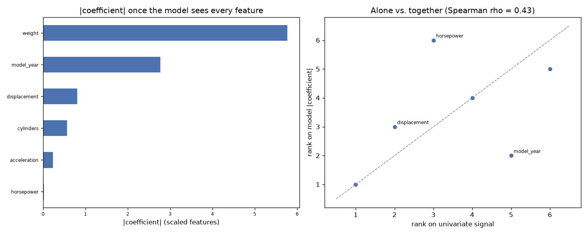

# Day 80 — seaborn `mpg` (398 rows · 8 features)

**Question:** Do the top-ranked features stay on top once a model sees them together?

**Method:** Ranked features one at a time by univariate signal, then fitted a scaled linear model on all of them and compared the two rankings place by place.

**Insights**
1. The fitted model leans hardest on **weight**, which the univariate ranking only placed #1 of 6.
2. 4 of the top 5 univariate features are still in the model's top 5 (Spearman rho = 0.43 across all 6) — the two views disagree more than they agree.
3. **model_year** moves the furthest, 3 places, which is what correlated features do once they have to share the credit.

**Next question this raises:** If the rankings disagree, which one picks the better small subset?

