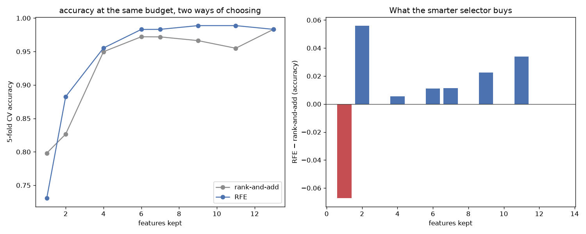

# Day 85 — sklearn `wine` (178 rows · 13 features)

**Question:** Would recursive feature elimination find a better subset of the same size?

**Method:** Scored every budget k two ways — the top-k univariate features, and the k features RFE keeps when it drops the weakest coefficients step by step — under identical 5-fold splits.

**Insights**
1. RFE beats rank-and-add at 6 of the 8 budgets tested, by at most 0.056 accuracy (at k = 2).
2. At k = 5 the two methods agree on 3 of 5 features (**color_intensity**, **flavanoids**, **proline**); RFE swaps in **alcohol**, **hue**.
3. The full table scores 0.983 accuracy, so the selector earns its compute here.

**Next question this raises:** Does the winning subset still win with a non-linear model?

