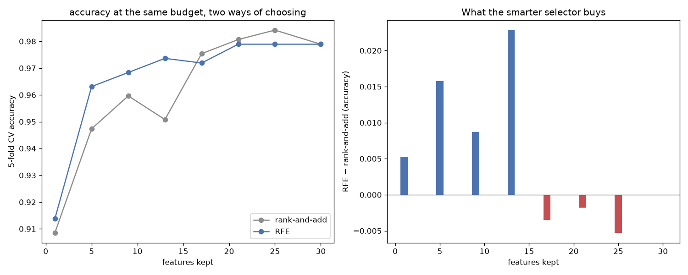

# Day 87 — sklearn `breast_cancer` (569 rows · 30 features)

**Question:** Would recursive feature elimination find a better subset of the same size?

**Method:** Scored every budget k two ways — the top-k univariate features, and the k features RFE keeps when it drops the weakest coefficients step by step — under identical 5-fold splits.

**Insights**
1. RFE beats rank-and-add at 4 of the 8 budgets tested, by at most 0.023 accuracy (at k = 13).
2. At k = 5 the two methods agree on 2 of 5 features (**worst concave points**, **worst radius**); RFE swaps in **radius error**, **worst area**, **worst texture**.
3. The full table scores 0.979 accuracy, so the selector earns its compute here.

**Next question this raises:** Does the winning subset still win with a non-linear model?

