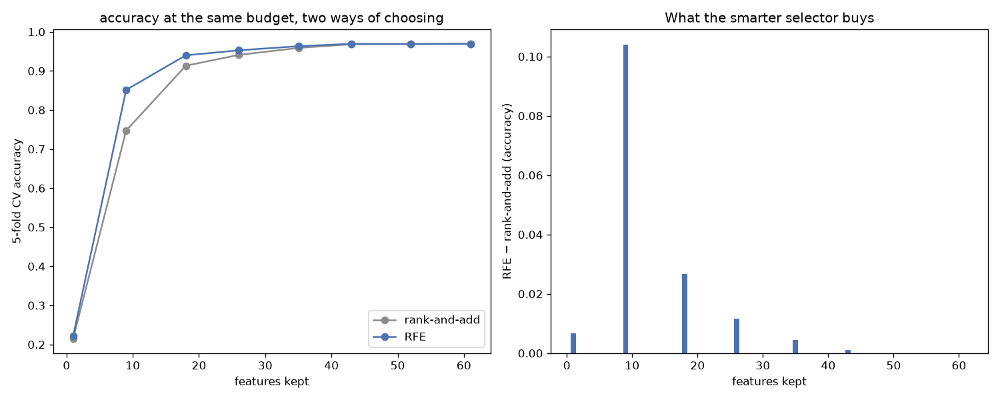

# Day 89 — sklearn `digits` (1,797 rows · 61 features)

**Question:** Would recursive feature elimination find a better subset of the same size?

**Method:** Scored every budget k two ways — the top-k univariate features, and the k features RFE keeps when it drops the weakest coefficients step by step — under identical 5-fold splits.

**Insights**
1. RFE beats rank-and-add at 6 of the 8 budgets tested, by at most 0.104 accuracy (at k = 9).
2. At k = 5 the two methods agree on 1 of 5 features (**pixel_2_5**); RFE swaps in **pixel_3_2**, **pixel_4_6**, **pixel_5_2**, **pixel_5_3**.
3. The full table scores 0.969 accuracy, so the selector earns its compute here.

**Next question this raises:** Does the winning subset still win with a non-linear model?

