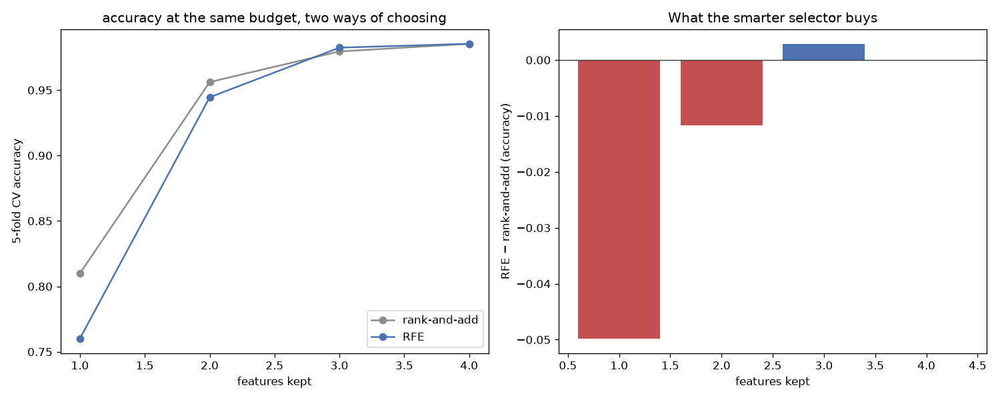

# Day 91 — seaborn `penguins` (344 rows · 6 features)

**Question:** Would recursive feature elimination find a better subset of the same size?

**Method:** Scored every budget k two ways — the top-k univariate features, and the k features RFE keeps when it drops the weakest coefficients step by step — under identical 5-fold splits.

**Insights**
1. RFE beats rank-and-add at 1 of the 4 budgets tested, by at most 0.003 accuracy (at k = 3).
2. At k = 4 the two methods agree on 4 of 4 features (**bill_depth_mm**, **bill_length_mm**, **body_mass_g**, **flipper_length_mm**); RFE swaps in nothing.
3. The full table scores 0.985 accuracy, so ranking univariately is good enough on this data.

**Next question this raises:** Does the winning subset still win with a non-linear model?

