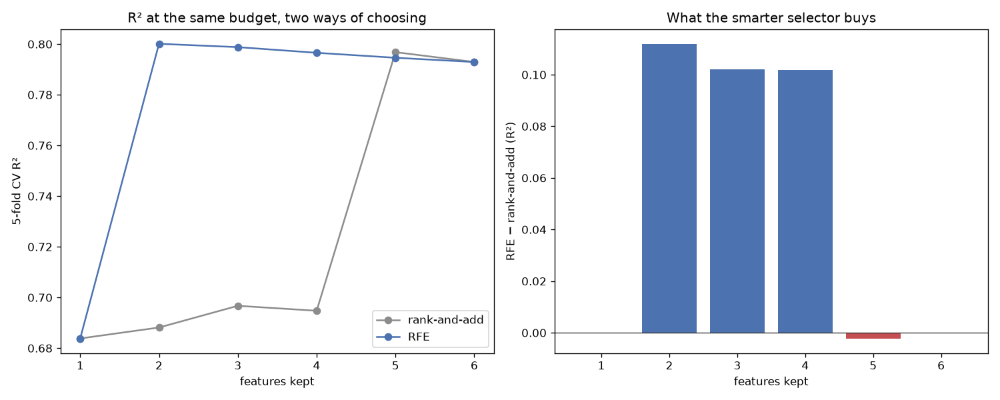

# Day 93 — seaborn `mpg` (398 rows · 8 features)

**Question:** Would recursive feature elimination find a better subset of the same size?

**Method:** Scored every budget k two ways — the top-k univariate features, and the k features RFE keeps when it drops the weakest coefficients step by step — under identical 5-fold splits.

**Insights**
1. RFE beats rank-and-add at 4 of the 6 budgets tested, by at most 0.112 R² (at k = 2).
2. At k = 5 the two methods agree on 4 of 5 features (**cylinders**, **displacement**, **model_year**, **weight**); RFE swaps in **acceleration**.
3. The full table scores 0.793 R², so the selector earns its compute here.

**Next question this raises:** Does the winning subset still win with a non-linear model?

