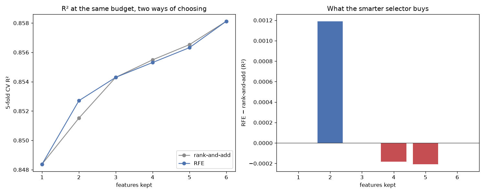

# Day 94 — seaborn `diamonds` (6,000 rows · 9 features)

**Question:** Would recursive feature elimination find a better subset of the same size?

**Method:** Scored every budget k two ways — the top-k univariate features, and the k features RFE keeps when it drops the weakest coefficients step by step — under identical 5-fold splits.

**Insights**
1. RFE beats rank-and-add at 1 of the 6 budgets tested, by at most 0.001 R² (at k = 2).
2. At k = 5 the two methods agree on 4 of 5 features (**carat**, **table**, **x**, **y**); RFE swaps in **depth**.
3. The full table scores 0.858 R², so ranking univariately is good enough on this data.

**Next question this raises:** Does the winning subset still win with a non-linear model?

